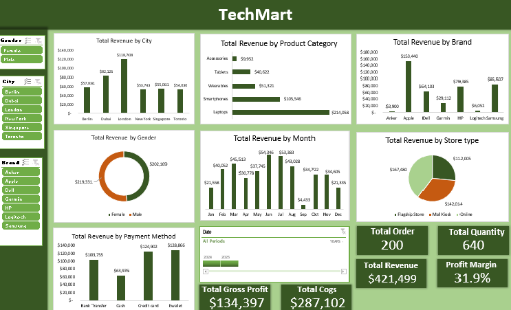

# TechMart - Retail Sales Dashboard | Excel

## Overview
Analyzed 200 sales transactions for TechMart electronics retailer to track revenue performance and profitability across cities, products, and sales channels.

## Key KPIs
- **Total Orders:** 200
- **Total Quantity:** 640
- **Total Revenue:** $421,499
- **Total COGS:** $287,102
- **Total Gross Profit:** $134,397
- **Profit Margin:** 31.9%

## Business Insights
- **Profitability:** 31.9% gross margin means $0.32 profit per $1 sale. Healthy margin.
- **Top Category:** Laptops generated highest revenue ($214,058) — 50% of total revenue.
- **Top Brand:** Apple leads by brand ($153,440), followed by Samsung ($85,507).
- **Top City:** London leads revenue by city ($114,708).
- **Seasonality:** Peak revenue in June ($63,389), lowest in September ($4,433).
- **Sales Channel:** Online Store dominates ($242,014) vs Mall Kiosk ($112,005) and Flagship Store ($67,480).
- **Payment Method:** Ewallet is most used ($128,866) followed by Credit Card ($124,902).

## Formula Used (Attention to Detail)
Profit Margin was NOT hard-coded. It is dynamically linked to prove calculation:

`KPI!H27 = G27/D27` = Total Gross Profit / Total Revenue
`Dashboard Shape = =KPI!H27` (auto-updates when data changes)

This replaces meaningless `Sum of Unit Price` with a real business metric that hiring managers look for.

## Tools Used
- Microsoft Excel (Pivot Tables, Pivot Charts, Slicers, Timeline)
- Data Cleaning, KPI Cards, Shape Linking, Percentage Formatting

## Files
- `TechMart.csv` - Raw sales data (200 rows)
- `TechMart.xlsx` - Cleaned data + KPI sheet + Dashboard
- `TechMart_Dashboard.png` - Final dashboard screenshot

## Author
**Ayodeji Orikogbo** | Aspiring Data Analyst | Excel
Building portfolio for entry-level data analyst roles.
GitHub: Orikogbo3
LinkedIn: www.linkedin.com/in/ayodejiorikogbo
